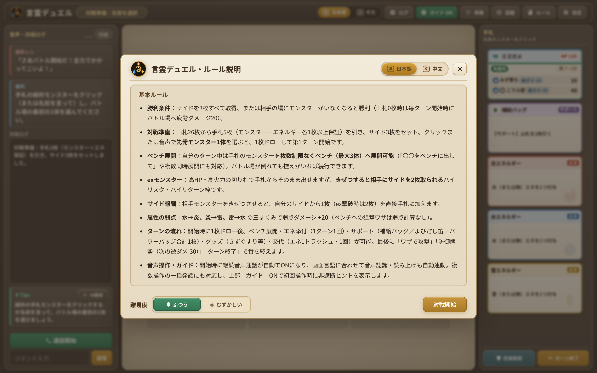
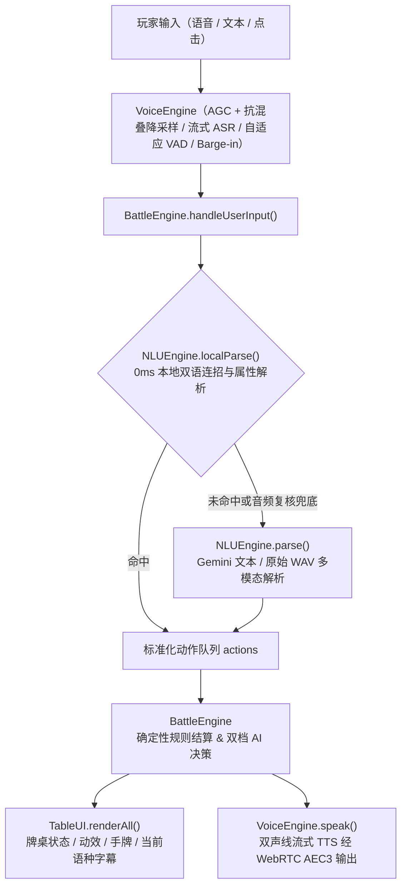

<div align="center">

# 言霊デュエル · 言灵对决

**纯前端、零构建依赖的中日双语全双工语音桌游卡牌对战**

[](https://ezta23x.github.io/kotodama-duel-voice-tcg/)
[](#快速启动)
[](#核心特性)
[](#系统架构与数据说明)

[在线试玩](https://ezta23x.github.io/kotodama-duel-voice-tcg/) · [核心特性](#核心特性) · [30 秒上手玩法](#30-秒上手玩法) · [快速启动](#快速启动) · [界面一览](#界面一览) · [系统架构](#系统架构与数据说明)

<br />


</div>

---

## 简介

**言灵对决（言霊デュエル）** 是一款在浏览器中开箱即玩的 **26 张卡组、3 奖赏卡制** 回合制语音卡牌对战游戏。  
玩家可随时在 **纯日语（默认）与纯中文** 之间无缝切换界面与语音，直接开口说出单步指令或一句话多步连招，也可配合键盘输入、鼠标点击或触屏操作。底层采用 **0ms 本地口语快通道 + 云端 Gemini 多模态复核兜底**，所有战斗结算由 **确定性本地规则引擎** 严格裁定，无需任何构建工具或后端即可部署运行。

> **立即体验**：访问 [https://ezta23x.github.io/kotodama-duel-voice-tcg/](https://ezta23x.github.io/kotodama-duel-voice-tcg/)（推荐使用 **Chrome / Edge** 并允许麦克风权限；不开麦克风也可全程点击或打字游玩）。

---

## 核心特性

### 全双工语音交互与多引擎音色
- **全双工持续收音 + 随时开口打断（Barge-in）**：通过本地 WebRTC 回环将 TTS 音频接入浏览器硬件级 AEC3 回声消除参考通道，支持免按键持续通话；开局引导、开幕播报与对局对话期间均可随时开口打断。
- **高准确率音频前端 + 多模态音频复核**：内置硬件 AGC、抗混叠 48kHz→16kHz 降采样、轻度音量均衡、句尾静音补帧及音效防串麦；默认根据当前界面语种锁定 SenseTime Nia 流式 ASR 语种并实时逐字上屏，当流式转写为空或存在听不清误识别时自动将原始 WAV 音频送往 Gemini 多模态复核兜底。
- **单语言无缝切换 + 全量音色库**：开局规则页、顶栏与设置面板均可一键切换 **纯日语（`ja`） / 纯中文（`zh`）** 且不中断当前对局或播报。内置 **SenseTime Nia 24kHz 流式 TTS**（日语 `JAPANESE` 9 种 + 中文 `ZH_CN` 53 种音色）、**Vertex Gemini TTS**（全部 30 种预置音色）与浏览器本地语音降级，裁判与对手「莲」各自独立选声线。
- **一句多步连招 + 语义自适应判停**：支持中/日无标点连续指令（如伤药、贴能量、召唤笛、攻击/防御一气呵成），结合声学静音与句尾语义双信号自适应判停，精准剥离怪兽/技能名解析三色能量属性；遇到多目标或多候选不臆断，追问确认后自动续跑剩余连招。

### 精致桌游视觉与多端体验
- **纯矢量 SVG 卡牌图鉴**：8 只原创怪兽、5 类道具/支援卡与品牌纹章全部采用定制矢量 SVG 绘制，高清无锯齿且不依赖外部图片资源。
- **温润桌游配色与防误触设计**：采用「深暖灰外框 → 柔灰咖双侧栏 → 温润亚麻牌桌 → 暖象牙卡牌」五档明度排版，桌面端 `100dvh` 一屏舒展呈献；内置横向滚轮/手势保护，防止触控板左右滑动时误触浏览器历史后退。
- **三端自适应 + 双档公平 AI**：自适应桌面横屏、手机横屏（支持顶栏全屏切换）与手机竖屏；提供「普通」与「困难」两档 AI（困难 AI 仅依据桌面公开信息进行整回合连招搜索与 2 回合局势评估），配套实时 Tips、AI 战术分析按钮、非遮挡新手引导与关键操作二次确认。

### JSON 驱动与零构建工程
- **单一数据源与热更新**：规则、26 张卡组、8 只怪兽与技能、道具/支援卡、对手台词、系统提示词与同音纠错词典集中在 [`gamedata.json`](./gamedata.json)，支持在设置页直接拖入自定义 JSON 热更新。
- **纯静态零依赖**：无打包器、无运行时外部依赖，本地一键启动或直接托管 GitHub Pages 即可游玩。

---

## 30 秒上手玩法

| 规则维度 | 核心设定 |
| --- | --- |
| **胜利条件** | 双方各 26 张卡组、盖放 **3 张奖赏卡**，先拿满 3 张奖赏卡（或击倒对手场上全部怪兽）获胜；牌库耗尽时每回合开始主战怪兽受到 20 点疲劳伤害 |
| **开局准备** | 起手 5 张（保底含怪兽与能量），点击或语音自选 1 只怪兽作为战斗区首发，亮牌后抽 1 张正式开始第 1 回合 |
| **备战区规则** | 己方回合中，手牌怪兽可**不限次数直接放入备战区**（最多 3 只）；主战怪兽被击倒时由备战区补位 |
| **属性克制** | **水克火 → 火克雷 → 雷克水**，命中弱点伤害 **+20**（狙击对手备战区不计弱点） |
| **ex 王牌怪兽** | 双方各 2 张（`160~170 HP`，具备高爆发或全后排溅射技能），可直接出场，被击倒时对手一次拿走 **2 张奖赏卡** |
| **技能机制** | 8 只怪兽涵盖过牌（`+1ドロー`）、减伤（`被ダメ-10/-20/-30`）、后排狙击（`狙撃`）、全后排溅射（`後列20`）、自愈（`回復+20`）、反伤（`反動20`）与弃能爆发（`エネ-1`） |
| **每回合限次** | 贴能量 `1 次` · 支援卡（补给包 / 召唤笛 / 力量徽章）合计 `1 次` · 撤退 `1 次`（普通弃 1 能、ex 弃 2 能）；普通道具（伤药 / 能量回收）不限次 |

### 常用语音 / 文字指令示例

| 你想做的操作 | 直接说日语 | 或直接说中文 |
| --- | --- | --- |
| 放怪兽到备战区 | 「ミズガメをベンチに出す」 | 「把水龟放到备战区」 |
| 指定属性贴能量 | 「炎エネルギーをヒノキツネに貼る」 | 「给水龟贴火能量」 / 「加一个电」 |
| 使用道具 / 支援卡 | 「補給バッグを使う」 / 「きずぐすり」 | 「用补给包抽牌」 / 「给前排吃伤药」 |
| 发动技能攻击 | 「ヒノキツネでひのこ」 | 「用火花攻击」 / 「炎狐放炎弹」 |
| 一句多步顺序连招 | 「ミズガメをベンチに出して炎エネルギーを貼って防御」 | 「给伤药上火能量用召唤笛拖对手换怪物然后战斗」 |
| 防御 / 撤退 / 结束 | 「防御」 / 「交代」 / 「ターン終了」 | 「防御姿态」 / 「撤退换雷狮」 / 「结束回合」 |

---

## 快速启动

### 方式一：在线试玩（推荐）

直接访问 GitHub Pages（HTTPS 环境原生支持麦克风与 WebRTC AEC3）：  
👉 **[https://ezta23x.github.io/kotodama-duel-voice-tcg/](https://ezta23x.github.io/kotodama-duel-voice-tcg/)**

### 方式二：本地一键运行

由于浏览器安全策略限制 `file://` 直接 `fetch()` 本地 JSON，推荐使用内置启动脚本（自动寻找可用端口，默认 `8080`，调用系统 `python3` / `python` / `npx serve`）：

```bash
git clone https://github.com/ezta23x/kotodama-duel-voice-tcg.git
cd kotodama-duel-voice-tcg
```

| 平台 | 运行方式 |
| --- | --- |
| **macOS** | 双击 `start.command`（如提示权限不足，终端执行一次 `chmod +x start.command`） |
| **Linux** | 终端运行 `./start.command` 或 `bash start.command` |
| **Windows** | 双击 `start.bat` |

> **直接双击打开**：若直接双击 `index.html`，页面会弹出本地文件引导窗，选择同目录下的 `gamedata.json` 即可游玩并自动缓存在浏览器中。

### 方式三：部署到你自己的 GitHub Pages

1. Fork 本仓库或推送文件到你的 GitHub 仓库。
2. 打开 **Settings → Pages**，在 **Build and deployment** 选择 **Deploy from a branch** → `main` 分支根目录 `/`。
3. 等待部署完成后打开 HTTPS 链接即可在电脑与手机端体验。

---

## 界面一览

### 1. 主对战牌桌

| 区域 | 说明 |
| --- | --- |
| **顶部工具栏** | 矢量言灵纹章、回合徽章、`日本語 / 中文` 切换胶囊、全屏切换（手机端）、调试日志抽屉（`ログ / 日志`）、新手引导开关、重开对局、图鉴、规则与设置 |
| **左侧语音・对局手账** | 对手与裁判对话气泡、追问快捷按钮、对局日志、实时 Tips + **AI 战术分析按钮**、全双工持续通话开关与文字输入框 |
| **中间帆布对战垫** | 敌我备战区（3 格）与主战区、奖赏卡进度、可查阅的牌库/弃牌区，以及中线本回合 `贴能 / 支援 / 撤退 1/1` 状态牌 |
| **右侧手牌与操作栏** | 手牌列表（支持点击出牌与拖拽排序，手机竖屏自动切换横向滑动）及底部「防御姿态 / 结束回合」固定操作栏 |

### 2. 开局规则与语言 / 难度选择页



### 3. 设置与热更新面板


在右上角「設定 / 设置」中可配置界面语种（`日本語` / `中文`）、**LLM 解析模型**、**ASR 语音识别**（SenseTime Nia 流式 / Gemini 音频直传 / Chrome 识别 / 离线本地）与 **TTS 语音合成**（SenseTime Nia 9 日语 & 53 中文音色 / Vertex Gemini 30 音色 / Chrome 浏览器音色），以及久未响应提醒秒数（默认 `15s`）、对手 AI 难度与 `gamedata.json` 拖放热更新。

---

## 项目结构

```text
kotodama-duel-voice-tcg/
├── index.html       # 页面结构、SVG 图标与五档明度三端响应式样式
├── app.js           # 核心单文件模块：DebugLog / GuideEngine / ConfigManager / SpecEngine /
│                    # VoiceEngine / NLUEngine / BattleEngine / TableUI / MobileViewportManager
├── gamedata.json    # 游戏数据中心（规则、牌组、怪兽/技能、道具、台词、Prompt、ASR 纠错词典）
├── start.command    # macOS / Linux 本地静态服务启动脚本
├── start.bat        # Windows 本地静态服务启动脚本
├── docs/            # 界面截图（battle-ui.png / rules-ui.png / settings-ui.png）
└── README.md        # 项目说明文档
```

---

## 系统架构与数据说明

<details open>
<summary><strong>1. 全链路数据流</strong></summary>



</details>

<details>
<summary><strong>2. <code>gamedata.json</code> 结构与热更新参考</strong></summary>

| 顶层字段 | 类型 | 说明 |
| --- | --- | --- |
| `schemaVersion` | `string` | 数据结构版本（`"2.0"`） |
| `rules` | `{ ja: string[], zh: string[] }` | 规则弹窗双语条目（支持 `**加粗**`） |
| `decks` | `{ player: string[], enemy: string[] }` | 双方初始 26 张标准卡组 |
| `monsters` | `Monster[]` | 怪兽定义（`id`、`side`、`name_ja/zh`、`element`、`hp`、`is_ex`、`skills[]`、`aliases[]`） |
| `items` | `Item[]` | 能量 / 道具 / 支援卡定义（`category`、`effect_type`、`desc_ja/zh`、`aliases[]`） |
| `rivalLines` | `Record<string, { ja, zh }[]>` | 按事件分组的对手台词池 |
| `promptInstructions` | `string` | 云端 NLU 系统提示词 |
| `asrCorrections` | `{ standard, variants[], meaning }[]` | 中/日口语别名与同音误识别纠错词典 |

#### 参数化效果语法（免改代码调数值）
在 `items[].effect_type` 或 `monsters[].skills[].effect` 中可直接调整数值或使用 `+` 组合效果（如 `guard_30+heal_self_20`）：
- `heal_ally_N` / `heal_self_N`：回复己方或自身 `N` 点 HP
- `draw_N`：抽 `N` 张牌
- `boost_N`：本回合攻击伤害 `+N`
- `guard_N`：下回合受击减伤 `N`
- `bench_splash_N`：对对手全体备战怪兽造成 `N` 点溅射伤害
- `recoil_N`：攻击后自身承受 `N` 点反伤
- `discard_self_N`：释放后弃置自身 `N` 点能量
- `switch_enemy_bench`：强拉对手 1 只备战怪兽上场
- `recover_energy`：从弃牌区（空时从牌库）取回 1 张能量

#### 热更新与调试日志
- **热更新**：直接编辑 `gamedata.json` 刷新页面，或在「設定 / 设置」底部拖入自定义 JSON 临时覆盖（点击恢复默认可清除）。
- **调试抽屉**：顶栏「ログ / 日志」支持按 `ALL / ASR / NLU / TTS / AEC / ERR` 过滤并一键导出无密钥 JSON 日志。
- **公开发布提示**：演示版内置了开箱测试密钥；如需正式对外公开部署，建议置空默认密钥或改为经由后端代理签发鉴权。

</details>
