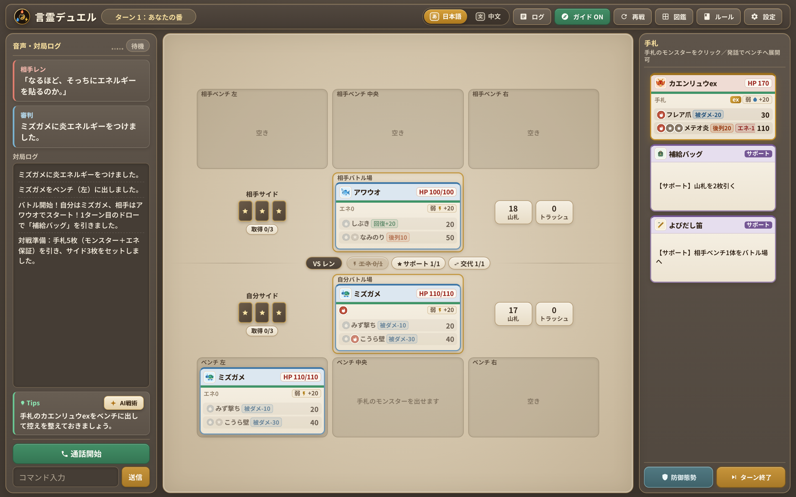
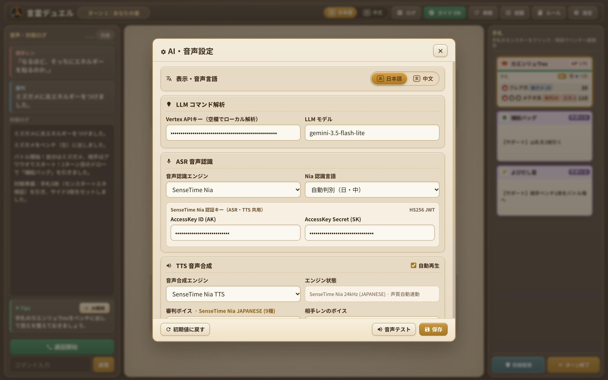
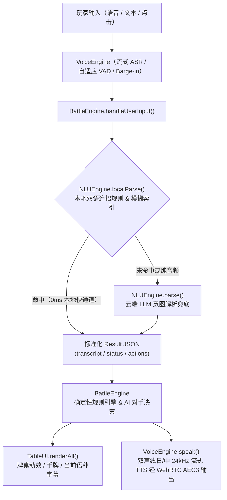

<div align="center">

# 言霊デュエル · 言灵对决

**纯前端、零构建依赖的中日双语全双工语音桌游卡牌对战原型**

[](https://ezta23x.github.io/kotodama-duel-voice-tcg/)
[](#快速启动)
[](#核心亮点)
[](#系统架构与二次开发)

[在线试玩](https://ezta23x.github.io/kotodama-duel-voice-tcg/) · [核心亮点](#核心亮点) · [30 秒上手玩法](#30-秒上手玩法) · [快速启动](#快速启动) · [界面一览](#界面一览) · [二次开发指南](#系统架构与二次开发)

<br />



</div>

---

## 简介

**言灵对决（言霊デュエル）** 是一款在浏览器中开箱即玩的 **26 张卡组、3 奖赏卡制** 回合制语音卡牌对战 Demo。  
你可以随时以 **纯日语（默认）或纯中文** 界面游玩，直接开口说出单步指令或连续多步连招，也可以配合键盘输入与鼠标/触屏点击操作。底层以 **0ms 本地口语快通道** 优先解析、云端 LLM 兜底，并由 **确定性本地规则引擎** 严格裁定全部战斗结算，无需任何构建工具或后端即可部署体验。

> **立即体验**：打开 [https://ezta23x.github.io/kotodama-duel-voice-tcg/](https://ezta23x.github.io/kotodama-duel-voice-tcg/)（推荐使用 **Chrome / Edge** 并允许麦克风权限；不开麦克风也可全程点击或打字游玩）。

---

## 核心亮点

### 全双工语音与单语言双声线联动
- **WebRTC AEC3 全双工通话 + 实时语音 HUD**：通过本地 WebRTC 回环将 TTS 音频接入浏览器硬件级回声消除参考通道，实现免按键持续收音与自然插话打断（Barge-in）；牌桌悬浮声波 HUD 实时提示「正在聆听 / 已执行 / AI 解析中」三态。
- **纯单语言切换 + 流式 TTS / ASR 联动**：开局规则页、顶栏与设置面板均可一键切换 **纯日语（`ja`） / 纯中文（`zh`）** 界面且不中断当前对局或语音播报。切换后，SenseTime Nia 24kHz 流式 TTS 自动在 `JAPANESE`（9 种日语音色）与 `ZH_CN`（9 种中文音色）间切换并重载正在播报的队列，流式 ASR 亦同步联动。
- **一句多步连招 + 严格反幻觉护栏**：支持日语 て形无标点连读与中文无标点连读，本地毫秒级拆分为顺序动作队列并内置子句级目标隔离与原文核对护栏；多候选不臆断，按规则追问确认后继续执行剩余连招。

### 精致桌游美术与多端适配
- **零闪屏启动 + 全矢量 SVG 图鉴**：内置黑金纹章启动遮罩、SVG 品牌与语种徽章，以及全部 **8 只怪兽与 5 类道具/支援卡的定制矢量 SVG 头像**，高清无锯齿且无需额外图片资源。
- **五档明度排版 + 触控板防误触**：采用「深暖灰外框 → 柔灰咖双侧栏 → 温润亚麻牌桌 → 暖象牙卡牌」五档明度阶梯与五档字号排版，桌面端 `100dvh` 一屏舒展呈献；内置全局横向滚轮/手势边界保护，防止 Mac 触控板左右滑动切牌时误触浏览器历史后退。
- **三端自适应 + 双档公平 AI**：自适应桌面横屏、手机横屏（含顶栏全屏切换）与手机竖屏；内置「普通」与「困难」两档 AI（困难 AI 100% 仅依据桌面公开信息进行整回合连招搜索与 2 回合局势评估），配套新手引导、AI 战术一键分析及防误触二次确认弹窗。

### 单一数据源与零构建工程
- **JSON 驱动与热更新**：全部规则、初始 26 张卡组、怪兽技能、道具效果、对手台词、Prompt 与 ASR 纠错词典集中定义在 [`gamedata.json`](./gamedata.json)，支持设置页直接拖入自定义 JSON 热更新。
- **零构建纯静态**：无打包器、无运行时依赖，双击脚本本地启动或直接托管 GitHub Pages 即可运行。

---

## 30 秒上手玩法

| 规则维度 | 核心设定 |
| --- | --- |
| **胜利条件** | 双方各 26 张卡组、盖放 **3 张奖赏卡**，先拿满 3 张奖赏卡（或击倒对手场上全部怪兽）获胜 |
| **开局准备** | 起手 5 张（保底含怪兽与能量），自选 1 只怪兽作为首发上场，亮牌后抽 1 张正式开始 |
| **备战区规则** | 己方回合中，手牌有怪兽卡即可**不限次数直接放到备战区**（最多 3 只）；主战怪兽倒下时由备战区补位 |
| **属性克制** | **水克火 → 火克雷 → 雷克水**，命中弱点时伤害 **+20**（狙击对手备战区不计弱点） |
| **ex 王牌怪兽** | 双方各 2 张（`160~170 HP`、3 费高爆发或全后排溅射大招），可直接出场，但被击倒时对手一次拿走 **2 张奖赏卡** |
| **技能特性** | 8 只怪兽各具专属机制：过牌（`+1ドロー`）、重盾减伤（`被ダメ-30`）、备战狙击（`狙撃`）、全后排溅射（`後列10/20`）、自愈（`回復+20`）、狂暴反伤（`反動20`）与弃能爆发（`エネ-1`） |
| **每回合限次** | 贴能量 `1 次` · 支援者卡（补给包 / 召唤笛 / 力量徽章）合计 `1 次` · 撤退 `1 次`（普通弃 1 能、ex 弃 2 能）；普通道具（伤药 / 能量回收）不限次 |

### 常用语音 / 文字指令示例

| 你想做的操作 | 直接说日语 | 或直接说中文 |
| --- | --- | --- |
| 放怪兽到备战区 | 「ミズガメをベンチに出す」 | 「把水龟放到备战区」 |
| 贴能量 | 「炎エネルギーをヒノキツネに貼る」 | 「给炎狐贴火能量」 |
| 使用道具 / 支援者 | 「補給バッグを使う」 / 「きずぐすり」 | 「用补给包抽牌」 / 「给前排吃伤药」 |
| 发动技能攻击 | 「ヒノキツネでひのこ」 | 「用火花攻击」 / 「炎狐放炎弹」 |
| 一句多步顺序连招 | 「ミズガメをベンチに出して炎エネルギーをヒノキツネに貼ってひのこ」 | 「把水龟放备战区给炎狐贴火能用火花攻击」 |
| 防御 / 撤退 / 结束 | 「防御」 / 「交代」 / 「ターン終了」 | 「防御姿态」 / 「撤退换雷狮」 / 「结束回合」 |

---

## 快速启动

### 方式一：直接在线试玩（推荐）

访问 GitHub Pages 托管地址（HTTPS 环境原生支持麦克风与 WebRTC AEC3）：  
👉 **[https://ezta23x.github.io/kotodama-duel-voice-tcg/](https://ezta23x.github.io/kotodama-duel-voice-tcg/)**

### 方式二：本地一键运行

由于浏览器安全策略限制 `file://` 协议通过 `fetch()` 读取本地 JSON，推荐使用内置启动脚本（自动寻找可用端口，默认 `8080`，调用系统自带的 `python3` / `python` / `npx serve`）：

```bash
git clone https://github.com/ezta23x/kotodama-duel-voice-tcg.git
cd kotodama-duel-voice-tcg
```

| 平台 | 运行方式 |
| --- | --- |
| **macOS** | 双击 `start.command`（如提示权限不足，终端执行一次 `chmod +x start.command`） |
| **Linux** | 终端运行 `./start.command` 或 `bash start.command` |
| **Windows** | 双击 `start.bat` |

> **离线双击打开**：直接双击 `index.html` 时会弹出引导窗，选择同目录下的 `gamedata.json` 即可游玩（选择一次后会自动缓存在浏览器中）。

### 方式三：部署到你自己的 GitHub Pages

1. Fork 本仓库或将项目文件推送到你的 GitHub 仓库。
2. 进入仓库 **Settings → Pages**，在 **Build and deployment** 选择 **Deploy from a branch** → `main` 分支根目录 `/`。
3. 等待约 30–60 秒部署完成后，打开生成的 HTTPS 链接即可在电脑与手机端访问。

---

## 界面一览

### 1. 主对战牌桌三栏分区

| 区域 | 说明 |
| --- | --- |
| **顶部工具栏** | 定制 SVG 言灵纹章、回合状态、`日本語 / 中文` 切换胶囊、全屏切换（手机端）、日志抽屉（`ログ / 日志`）、新手引导开关、重开对局（带二次确认）、图鉴、规则与设置 |
| **左侧语音・对局手账** | 对手与裁判单语对话气泡、追问快捷按钮、对局日志、本地实时 Tips + **AI 战术分析按钮**、全双工持续通话控制与文本指令输入框；全链路调试日志抽屉亦从此侧平铺展开 |
| **中间帆布对战垫** | 敌我备战区（3 格）与主战区、奖赏卡进度、可点击查阅的牌库/弃牌区，以及中线本回合 `贴能 / 支援 / 撤退 1/1` 状态牌 |
| **右侧手牌与回合操作** | 纵向手牌列表（支持点击使用与拖拽排序，手机竖屏自动切换为横向滑动）及底部「防御姿态（下回合受击 -30）/ 结束回合」固定操作栏 |

### 2. 开局规则与难度 / 语言选择页


### 3. 设置与热更新面板



点击右上角「設定 / 设置」可一键切换界面与配音语言（`日本語` / `中文`），并分别配置 **LLM 指令解析**、**ASR 语音识别（SenseTime Nia / Gemini 音频直传 / Chrome 识别 / 离线本地）** 与 **TTS 语音合成（SenseTime Nia / Vertex Gemini / 浏览器内置）**；切换语言或引擎时音色选择栏会自动联动对应语种的合法音色目录，并支持调整无响应提醒秒数（默认 `15s`）、对手 AI 难度及拖放 `gamedata.json` 实现零代码热更新。

---

## 项目结构

```text
kotodama-duel-voice-tcg/
├── index.html       # 页面骨架、矢量 SVG 纹章、五档明度/字号单语言排版与三端响应式 CSS
├── app.js           # 9 大核心模块：DebugLog / GuideEngine / ConfigManager / SpecEngine /
│                    # VoiceEngine / NLUEngine / BattleEngine / TableUI / MobileViewportManager
├── gamedata.json    # 唯一游戏数据源（规则、牌组、怪兽/技能、道具、台词、Prompt、ASR 词典）
├── start.command    # macOS / Linux 本地静态服务一键启动脚本
├── start.bat        # Windows 本地静态服务一键启动脚本
├── docs/            # README 演示截图（battle-ui.png / rules-ui.png / settings-ui.png）
└── README.md        # 项目说明与二次开发文档
```

---

## 系统架构与二次开发

面向需要接入团队自研 **ASR / TTS / LLM** 或二次扩展卡池的研发同学，点击下方展开完整技术文档：

<details open>
<summary><strong>1. 系统架构与全链路数据流（Mermaid 流程图）</strong></summary>



</details>

<details>
<summary><strong>2. 替换语音识别（ASR）、语音合成（TTS）与大模型（NLU / LLM）接口</strong></summary>

`app.js` 采用单文件 IIFE 模块化分区设计，对接自研服务只需替换以下入口：

#### ① 语音识别（ASR）
- **统一指令入口**：
  ```js
  BattleEngine.handleUserInput({
    text: "ヒノキツネでひのこ", // 识别文本（支持日语或中文）
    audioBase64: null,          // 可选：多模态模型直听音频时传入 Base64
    audioMime: "audio/webm",    // 可选：音频 MIME 类型
    fromVoice: true             // 标记来自语音输入
  });
  ```
- **核心替换点（`VoiceEngine`）**：
  - `startContinuousAsrCall()` / `stopCall()`：全双工持续通话启停，断网或鉴权失败时自动降级浏览器 ASR 并支持在线恢复回连。
  - `createNiaAsrSession()`：内置 WebSocket `16kHz` Int16LE PCM 流式 ASR 接入实现（默认 SenseTime Nia），识别完成后通过 `this.callCallback({ text, fromVoice: true })` 触发解析。
  - `spawnContinuousRec()` / `restartChromeAsrIfNeeded()`：浏览器 Web Speech API 降级与语种热重启通道。
  - `startVadMonitor()`：本地 `AudioContext + AnalyserNode` 声学与 ASR 文本双信号自适应判停、`650ms` 预缓冲与全双工语义/强音量打断（`fadeOutAndStopPlayback()` / `stopPlayback()`）。

#### ② 语音合成（TTS）
- **统一播报入口**：`await VoiceEngine.speak({ ja, zh }, role, opts)`（`role`: `"referee" | "rival"`，`opts.priority`: `"critical" | "high" | "normal" | "low"`，内置 4 级子句边界让位与 `replayCurrentQueueInLang()` 切换语种实时重播）。
- **核心替换点（`VoiceEngine`）**：
  - `ensureNiaTtsStream(text, role, lang)` / `speakNiaTts(...)`：SenseTime Nia WebSocket `24kHz` PCM 边收边播流式 TTS 实现（支持 `JAPANESE` 与 `ZH_CN`）。
  - `fetchTtsAudioBuffer(text, role, lang)`：Vertex Gemini REST TTS 接入实现；替换为任意自研 TTS 并返回标准 Web Audio `AudioBuffer`，即可复用整套 `ensureAecOutput()` WebRTC AEC3 回声消除与 LRU 缓存机制。
  - `speakChrome(text, role, token, lang)`：浏览器本地 `speechSynthesis` 离线降级通道。

#### ③ 大模型 / 意图识别（NLU / LLM）
- **请求封装（`ConfigManager`）**：`buildRestUrl(model)`、`buildAuthHeaders()`（Gemini LLM），以及 `generateNiaJwt()`（HS256 JWT 签发）。
- **解析逻辑（`NLUEngine`）**：`localParse(...)`（本地规则 + 模糊索引）与 `parse(...)`（云端 Gemini 兜底，由 `SpecEngine.buildSystemPrompt()` 自动拼装 System Prompt）。
- **标准输出协议（支持单步或多步连招 `actions`）**：
  ```json
  {
    "transcript": "识别/修正后的玩家原始发话",
    "status": "execute | clarify | reject | confirm | chat | ignore",
    "actions": [
      {
        "type": "ATTACH_ENERGY | PLAY_BENCH | USE_ITEM | ATTACK | DEFEND | RETREAT | END_TURN | SURRENDER | INSPECT | CANCEL",
        "card_id": "手牌卡牌 ID 或 null",
        "skill_name": "技能日语名（如 ひのこ）或 null",
        "target": "player_active | player_bench_0..2 | enemy_active | enemy_bench_0..2 | null"
      }
    ],
    "reply_ja": "简短日语裁判回复",
    "reply_zh": "对应中文翻译",
    "rival_ja": "可选：对手互动回应（日语）",
    "rival_zh": "可选：对手互动回应（中文）"
  }
  ```

#### ④ 视口与交互扩展
- `BattleEngine`：包含 `normal`（稳健常规）与 `hard`（仅读公开信息的整回合联合连招搜索 + 2 回合局势评估）两档 AI 决策引擎。
- `TableUI`：卡牌、特效标签、动效、单语言气泡/日志渲染与手牌拖拽排序。
- `MobileViewportManager`：负责手机端（含手机切 PC 模式）识别与顶栏全屏切换按钮状态同步。

</details>

<details>
<summary><strong>3. <code>gamedata.json</code> 数据结构、参数化效果与热更新指南</strong></summary>

| 顶层字段 | 类型 | 说明 |
| --- | --- | --- |
| `schemaVersion` | `string` | 数据结构版本号（当前 `"2.0"`） |
| `rules` | `{ ja: string[], zh: string[] }` | 规则弹窗展示的双语条目（支持 `**加粗**`） |
| `decks` | `{ player: string[], enemy: string[] }` | 双方初始 26 张标准牌组 |
| `monsters` | `Monster[]` | 怪兽定义（`id`、`side`、`name_ja/zh`、`element`、`hp`、`is_ex`、`skills[]`、`aliases[]`） |
| `items` | `Item[]` | 能量 / 道具 / 支援者定义（`category`、`effect_type`、`desc_ja/zh`、`aliases[]`） |
| `rivalLines` | `Record<string, { ja, zh }[]>` | 按事件分组的对手台词池（自动轮换） |
| `promptInstructions` | `string` | 云端 NLU 系统指令模板 |
| `asrCorrections` | `{ standard, variants[], meaning }[]` | 日语同音误识别与中文别名纠错词典 |

#### 内置参数化效果（免改代码调数值）
在 `items[].effect_type` 或 `monsters[].skills[].effect` 中可直接修改数值，或用 `+` 组合多项效果（如 `guard_30+heal_self_20`、`bench_splash_10+discard_self_1`）：
- `heal_ally_30` / `heal_self_20` → 回复己方或自身指定数值 HP
- `draw_1` / `draw_2` → 发动技能或使用道具时抽指定张数卡牌
- `boost_20` → 本回合攻击增伤指定数值
- `guard_20` / `guard_30` → 发动后下回合受击减伤指定数值
- `bench_splash_10` / `bench_splash_20` → 攻击同时对对手全体备战怪兽造成溅射伤害
- `recoil_20` → 发动技能后自身承受指定数值反伤
- `discard_self_1` → 释放技能后弃置自身指定数量能量
- `switch_enemy_bench` → 强制将对手 1 只备战怪兽拉上战斗区
- `recover_energy` → 从弃牌区（空时从牌库）取回 1 张能量到手牌

#### 热更新方式
- **修改文件**：直接编辑 `gamedata.json` 并刷新页面（内置防缓存参数）。
- **页面内临时测试**：在「設定 / 设置」底部拖入自定义 `gamedata.json` 立即生效；点击「初期値に戻す / 恢复默认」即可清除覆盖缓存。

</details>

<details>
<summary><strong>4. 调试日志、浏览器存储键与安全部署建议</strong></summary>

- **全链路调试日志**：点击顶栏「ログ / 日志」打开调试抽屉，支持按 `ALL / ASR / NLU / TTS / AEC / ERR` 过滤，以及一键复制或导出 JSON 日志（导出内容不含任何密钥）。
- **浏览器存储键**：
  - `localStorage["elemental_table_api_cfg_v14"]`：界面语种、LLM / ASR / TTS 引擎、密钥、音色、无响应秒数（默认 `15`）、难度等用户配置
  - `localStorage["kotodama_duel_imported_gamedata_v2"]`：页面手动导入的 `gamedata.json` 覆盖缓存
- **公开发布安全提示**：当前演示版为方便开箱体验内置了默认测试密钥。如用于正式对外公开部署，建议将 `app.js` 中的默认 Key 置空，或将云端推理与语音鉴权改为经由后端代理转发，避免前端密钥被滥用。

</details>
